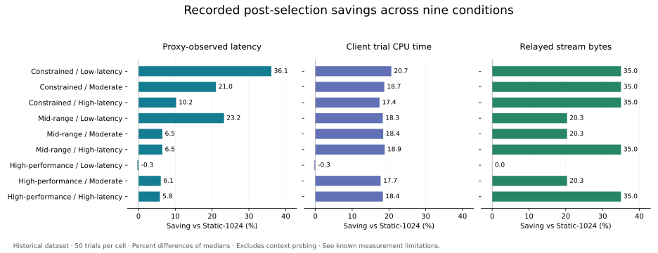

<div align="center">


# AdaptiveQKE
### Context-Aware Hybrid Key Exchange for TLS Channels

**A research prototype for selecting an ECDH + ML-KEM group before a TLS 1.3 handshake.**

[Quick start](#quick-start) · [How it works](#how-it-works) · [Recorded results](#recorded-results) · [My contributions](#my-contributions) · [Limitations](docs/KNOWN_ISSUES.md)

Python 3.10+ · TLS 1.3 · OpenSSL / OQS · Linux experiment harness · Offline visual demo

</div>

## Overview

AdaptiveQKE explores how endpoint constraints and network conditions can inform hybrid key-exchange selection. A deterministic, two-stage policy first selects a candidate using measured round-trip time (RTT), then caps it according to CPU and memory limits. The selected group is configured before the standard TLS 1.3 handshake begins.

The project combines a Python experiment harness, recorded datasets, a dissertation, a defense presentation, and an interactive web demonstration. It was developed as a **team graduation project at the University College of Applied Sciences (UCAS), Gaza**. This repository is presented by **[Weaam Raed Abdalaal](https://github.com/WeaamR)**, with individual contributions identified below.

> **Research status:** The original experimental core and datasets are preserved byte-for-byte. A subsequent code review found weaknesses in handshake-success detection and measurement boundaries. Recorded results are historical observations, not independently validated proof that every TLS handshake completed. Read [Known issues](docs/KNOWN_ISSUES.md) before interpreting or reproducing measurements. This is a research prototype, not a production security library.

## Quick start

The offline dashboard needs only Python's standard library. It does not require OQS, administrator privileges, or pip packages.

```bash
cd adaptiveqke
bash run_demo.sh
```

Open **http://127.0.0.1:8765**. Stop with `Ctrl+C`.

On Windows, or when launching directly in a clean Python environment:

```bash
python app.py
```

If your shell exports a custom `OPENSSL_CONF` or `OPENSSL_MODULES`, use the shell launcher on Linux/macOS; it isolates these settings from the dashboard process. See [Setup](docs/SETUP.md).

| Mode | What actually runs | Requirements |
|---|---|---|
| Dataset Replay | Summaries of 50 recorded trials per condition/configuration | Python 3.10+ |
| Policy Sandbox | Original policy engine on manually supplied context | Python 3.10+ |
| Live Lab | Original experiment code for one new TLS connection attempt | Original Linux/OQS environment and host privileges |

The workflow animation is explanatory, not a live event trace. Baseline comparison charts always use the recorded dataset, including when a Live Lab attempt is displayed. The live adapter inherits the documented limitations of the frozen core.

## How it works

1. **Collect context:** estimate RTT through concurrent TCP connection probes; obtain endpoint resource limits.
2. **Select a network candidate:** apply fixed RTT thresholds of 50 and 100 ms.
3. **Validate the device tier:** retain or cap the candidate using CPU/memory limits.
4. **Configure the TLS client:** pass the selected group to OpenSSL before the handshake.
5. **Measure the trial:** log timing, CPU time, and relayed byte counts.

In the experiment runner, policy selection uses the configured device-profile limits. Actual cgroup limits are read inside the trial process and logged separately. Bandwidth and packet loss are experimental settings, not direct policy inputs.

| Device tier | RTT < 50 ms | 50 ≤ RTT ≤ 100 ms | RTT > 100 ms |
|---|---|---|---|
| High-performance | 1024 | 768 | 512 |
| Mid-range | 768 | 768 | 512 |
| Constrained | 512 | 512 | 512 |

| Label | OpenSSL group | Classical component | PQ component |
|---|---|---|---|
| 512 | `x25519_mlkem512` | X25519 | ML-KEM-512 |
| 768 | `X25519MLKEM768` | X25519 | ML-KEM-768 |
| 1024 | `SecP384r1MLKEM1024` | secp384r1 | ML-KEM-1024 |

The ML-KEM parameter sets correspond to NIST categories 1, 3, and 5. These labels are not an end-to-end security rating for the entire TLS connection; certificate authentication remains classical. The 512 hybrid uses a private-use group identifier in this experiment. Stage 0 application security floors/ceilings are conceptual and are not implemented.

See [Architecture](docs/ARCHITECTURE.md) for components and measurement definitions.

## Recorded results

The supplied files contain **1,800 main trials** (3 devices × 3 networks × 4 configurations × 50 trials) and **450 near-zero-network trials** (3 devices × 3 groups × 50 trials). All rows are marked successful by the original logger; its success flag has the limitation described above.

Recomputed from the main CSV, the unweighted mean of the nine condition-level percentage savings against Static-1024 is:

| Recorded metric | Mean saving | Interpretation |
|---|---:|---|
| Proxy-observed latency | 12.79% | Post-selection; excludes context probing |
| Client trial CPU time | 16.48% | Includes Python/OpenSSL trial overhead |
| Relayed stream bytes | 26.22% | Excludes IP/TCP headers and retransmission bytes |



These percentages describe the preserved dataset. They are not universal speedups, first-connection savings, or validation of the measurement boundaries. The policy retains the strongest evaluated tier under favorable conditions and does not always minimize latency. Its 450/450 rule matches establish implementation consistency, not globally optimal thresholds.

Context probing costs approximately 21.6, 71.8, and 122.2 ms across the three network profiles. The frozen runner probes on **every Adaptive trial**; caching is future work. Replay first-connection cost is the **median of each trial's wire latency + probe cost**, with policy cost reported separately.

### Recompute and verify

```bash
python analysis/verify_integrity.py
python analysis/summarize.py
python -m unittest discover -s tests -v
```

Analysis writes CSV/JSON summaries to `analysis/generated/`. Optional independent percentile-bootstrap intervals:

```bash
python analysis/summarize.py --bootstrap 10000 --seed 20261013
```

The analysis script was added during repository preparation; it is not the original thesis-analysis script. See [Data and reproducibility](docs/DATA.md).

## My contributions

**Weaam Raed Abdalaal — policy design and implementation, data visualization, and interactive demo development.**

I independently completed:

- Design of the two-stage selection policy, including RTT rules, device classification, and CPU/memory thresholds.
- Implementation of the Python policy engine.
- Production of the project's charts and tables.
- Design of the interactive demo interface and explanatory workflow.
- Development of the web demo and its integration with the project implementation.

I collaborated with the team on research-problem formulation, literature review, Linux/OpenSSL/OQS environment setup, debugging and testing, dataset validation, statistical analysis, interpretation of results, report writing, and presentation preparation.

I also reviewed and discussed the design and implementation of the remaining system components with the team. Review contributions are distinct from implementation ownership. See [Contributions](docs/CONTRIBUTIONS.md).

## Team and academic context

| Team member | Credit |
|---|---|
| Heba Abd El-Salam Ajjour | Graduation-project co-author |
| Weaam Raed Abdalaal | Graduation-project co-author; individual contributions detailed above |
| Hala Ashraf Nasrallah | Graduation-project co-author |
| Farah Hussein Rajab | Graduation-project co-author |

**Supervisor:** Eng. Hadi El-Nabris  
**Institution:** University College of Applied Sciences (UCAS), Gaza  
**Program:** Cyber Security Engineering / Computer Engineering  
**Project year:** 2026

Specific implementation ownership for other team members is not assigned here without their contribution details.

## Repository guide

| Path | Contents |
|---|---|
| `core/` | Frozen original policy, TLS, metrics, enforcement, and experiment code |
| `app.py`, `web/` | Interactive dashboard backend and frontend |
| `data/` | Original main and crypto-phase CSV datasets |
| `analysis/` | Independent integrity checks and summary generation |
| `tests/` | Policy, dataset, and replay regression tests |
| `config/` | Instructions for the missing original OQS configuration |
| `docs/` | Setup, architecture, attribution, limitations, report, and slides |
| `assets/` | Repository banner and data-derived chart |
| `SOURCE_MANIFEST.sha256` | Original supplied manifest |
| `ORIGINAL_SHA256SUMS` | Frozen core and dataset fingerprints |

## Documentation

- [Dissertation](docs/Graduation_Project.pdf)
- [Defense presentation](docs/Graduation_Project_Presentation.pdf)
- [Setup and troubleshooting](docs/SETUP.md)
- [Architecture and measurement scope](docs/ARCHITECTURE.md)
- [Data definitions and reproduction](docs/DATA.md)
- [Known issues and research boundaries](docs/KNOWN_ISSUES.md)
- [Arabic demonstration script](docs/DEMO_SCRIPT_AR.md)
- [Repository changes](CHANGELOG.md)
- [GitHub upload guide](docs/PUBLISHING.md)

## Reuse and citation

No open-source license has been selected for this team-owned material. This package does not grant an open-source license; see [Rights](RIGHTS.md). Cite the team project using [CITATION.cff](CITATION.cff). External OpenSSL/OQS components retain their own licenses and are not bundled here.
